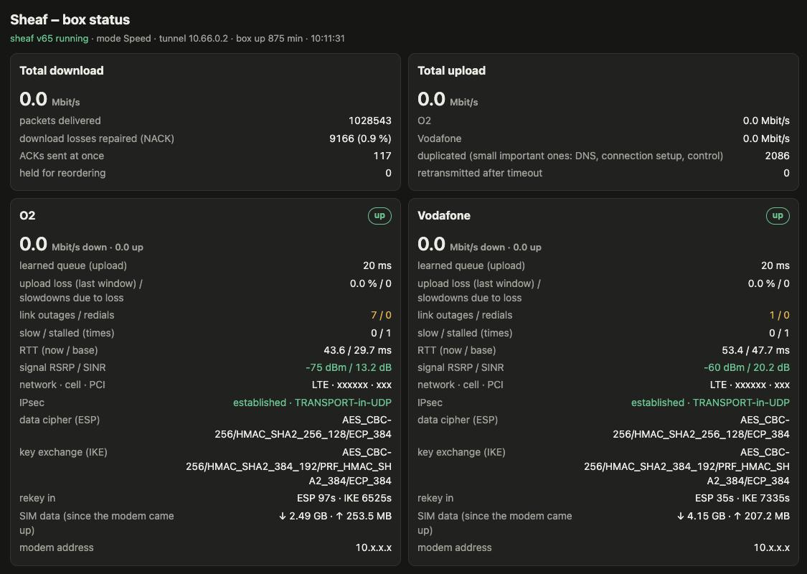
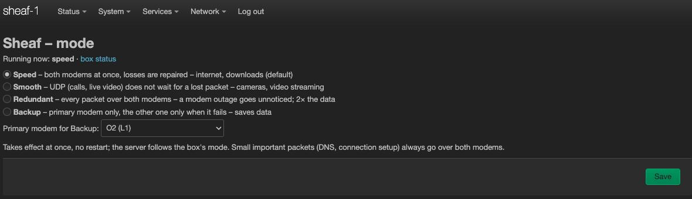

# sheaf

**sheaf** joins several LTE modems, each on a different operator, into one connection. A box with the modems sends
your traffic over all of them at once, and a server on the internet puts it back together. The devices behind the box
see one ordinary internet connection that keeps working when a modem loses signal and keeps a usable delay while the
cells under it change. It was built for places where one mobile connection is not enough, such as a car or a van,
cameras and live video from the field, calls and remote control.

Both ends run the same program, written in Go, with its own protocol; every modem's traffic is encrypted with IPsec
(strongSwan). Two box variants were built and measured:

- **A single box:** a MikroTik RBM33G (MT7621, 880 MHz MIPS) with two Huawei ME909s LTE modems, running OpenWrt 25.12.
- **A hub with satellites:** a BPI-R4 (Cortex-A73) runs sheaf and IPsec, and RBM33G boxes in the satellite role only
  carry their modems (four LTE links in the tests). The hub uses whichever satellites are plugged in.

```
   car / field                       the box                                  server                  internet
 ┌─────────────┐              ┌──────────────────────┐   LTE operator 1   ┌────────────────┐
 │ laptop      │              │                      │ ═════ modem 1 ════►│                │
 │ camera      │──── LAN ────►│   sheaf  (2 modems)  │                    │     sheaf      │──────► web, cloud,
 │ phone       │   (cable,    │                      │ ═════ modem 2 ════►│                │        video service
 └─────────────┘    Wi-Fi)    └──────────────────────┘   LTE operator 2   └────────────────┘
                                         each modem's traffic is encrypted (IPsec)
```

## Status

**A finished lab project (November 2026), no longer developed.** The final version is sheaf v65 with the OpenWrt
packages 65-r1. It was tested on the hardware above with SIMs of O2, Vodafone and T-Mobile (Czech Republic),
stationary, against a Linux server with 1 Gbit/s; QMI and MBIM modem support is written but was never run on
hardware. All results, the method and the evaluation are in **[docs/RESULTS.md](docs/RESULTS.md)**.

| what (one TCP flow, IPsec on) | result |
|---|---|
| BPI-R4 hub, four LTE links, through the tunnel | **158–188 Mbit/s** down with the 1–2 MB flow queue (6 runs), **108** up; no stall in any of 17 v59 runs (v57: 4 of 7) |
| same two SIMs as the single box, BPI-R4 as the brain | 73, 74 and 82 Mbit/s = **82–92 %** of the two raw links used together (89); the best run about equal to the best link alone (79) |
| single RBM33G box, two LTE links | tunnel **38–41 Mbit/s**, transparent TCP proxy **45–48 Mbit/s** |
| lab, emulated links, vs an ideal single link with the summed rate | 95 % static and varying, 89 % "drive" |
| reliability tests on the box (restarts, address changes, lost keys, zombie modem, throttled SIM, rekey, power cut, overnight run) | all passed, some after fixes (hardware caveat: inserting a SIM while running resets the box) |

**What the results mean:**

- **The concept works on a fast enough CPU.** On the BPI-R4 the bond carries one TCP flow at 82–92 % of the sum of
  two links used together and, with four links, at 158–188 Mbit/s (the best link alone, in backup mode through sheaf:
  100–104).
- **The RBM33G is too weak for the bonding software at LTE speeds.** Its CPU time per packet is the limit (~720 µs
  against ~70 µs on one Cortex-A73 core): even after flowtable, HalfSipHash and GSO writes into the TUN device, a
  single box is slower than its best modem alone when that modem has a good signal. On the RBM33G the bond buys
  reliability (a modem failure is invisible to the LAN), not speed. For practical use choose an ARM64 or x86 class box
  such as the BPI-R4; the RBM33G remains fine as a satellite that only carries modems, or where reliability matters
  more than speed.

## How it works, in five sentences

1. **The box spreads packets over all modems**, each packet going to the modem where it will arrive first, so even a
   single download or upload uses all modems at once.
2. **Every packet is numbered.** The far end puts the packets back in order per flow, notices exactly which ones went
   missing and asks for them again, and they are resent over whichever modem is best at that moment.
3. **The speed and delay of each modem are measured continuously**, so no modem is given more than it can carry right
   now; a modem that stops answering is detected quickly and its packets go over the others, and a persistently slow
   one (a throttled SIM) is set aside.
4. **Every modem's traffic is encrypted with IPsec** (on the RBM33G in its EIP93 crypto engine), and every packet also
   carries a tag that the far end checks.
5. **The mode decides what matters most**: raw speed, smooth live audio and video, invisible failover, or saving data
   on an expensive SIM.

On a slow box, the LAN's TCP connections can be carried by a transparent TCP proxy instead of the tunnel, which costs
the box far less CPU per byte. Details: [docs/HOW-IT-WORKS.md](docs/HOW-IT-WORKS.md).

## Modes

The mode is chosen on the box (LuCI → Services → Sheaf). It applies at once, and the server follows by itself.

| mode | what it does | use it for | what it costs |
|---|---|---|---|
| **Speed** (default) | uses all modems together and repairs every loss | internet, downloads, the web | after a loss, the affected connection waits a moment for the repair |
| **Smooth** | like speed, but live audio and video (UDP) wait only a few tens of milliseconds for a repair, then go on without it | calls, cameras, live video | now and then a tiny gap instead of a freeze |
| **Redundant** | sends every packet over every modem, and the first copy wins | remote control, telemetry, critical calls: losing a modem goes unnoticed | the data volume times the number of modems, at most the speed of the slower modem |
| **Backup** | uses only the main modem; the others take over if it fails | saving data on an expensive SIM | the speed of one modem |

In every mode, small important packets (DNS queries, connection setup) go over two modems.

## Quick start

Everything is described step by step in **[docs/USAGE.md](docs/USAGE.md)**:

- **The box:** install the two packages `sheaf` and `luci-app-sheaf` on OpenWrt 25.12 (built by
  `openwrt/build-apk.sh`, unsigned on purpose: `apk add --allow-untrusted …`), or flash a firmware image built by
  `openwrt/firmware/build-fw.sh` (it also carries the EIP93 driver fix). Put the two keys in place
  (`/etc/sheaf/sheaf.key` and `/etc/swanctl/conf.d/sheaf-secret.conf`, mode 600), set the server in
  `/etc/sheaf/sheaf.conf`, and run `/etc/init.d/sheaf restart`
  ([USAGE.md 1](docs/USAGE.md#1-the-box)).
- **The server:** any Linux host with a public IPv4 address and strongSwan; one systemd instance of sheaf per box
  (`server/sheaf.service`, `sheaf@.service`) and an IPsec responder ([USAGE.md 2](docs/USAGE.md#2-the-server)).
- **Hub and satellites:** `sheaf-role satellite N` on an RBM33G, `hub/hub-setup.sh` on the BPI-R4
  ([USAGE.md 1.5](docs/USAGE.md#15-hub-and-satellites)).
- **Building:** `GOOS=linux GOARCH=mipsle GOMIPS=softfloat go build` in `sheaf/` for the RBM33G,
  `GOOS=linux GOARCH=amd64` for the server ([USAGE.md 3](docs/USAGE.md#3-building-sheaf)).

Everyday use: power on the box and wait a little over a minute; it dials the modems, connects to the server and routes
the LAN through the tunnel by itself. Status: **http://192.168.1.1/sheaf.html** from the LAN (read only, no login).
Mode: LuCI → **Services → Sheaf**.



*The status page of an idle box (sheaf v65, speed mode, both links up, IPsec with ECP-384). Cell identifiers and modem
addresses are hidden.*



*LuCI → Services → Sheaf: the four modes and the primary modem for Backup.*

## Documents

| document | contents |
|---|---|
| [docs/RESULTS.md](docs/RESULTS.md) | every test result (lab, hub, single box, IPsec, reliability tests, overnight run), the method, conclusions and what was not verified |
| [docs/HOW-IT-WORKS.md](docs/HOW-IT-WORKS.md) | the mechanisms: scheduler, flow queue, window regulator, pacing, repair, per-flow order, modes, failure detection, transparent proxy, security, the CPU of a small box, limitations |
| [docs/PROTOCOL.md](docs/PROTOCOL.md) | the packet format, byte by byte, with sequence diagrams and worked examples |
| [docs/USAGE.md](docs/USAGE.md) | installing and running the box and the server, all command-line flags, the status JSON, building, measuring tools, repository layout |


## License

Copyright (C) 2026 Petr Wozniak

sheaf is free software: you can redistribute it and/or modify it under the terms of the GNU General Public License as
published by the Free Software Foundation, either version 3 of the License, or (at your option) any later version.
It is distributed in the hope that it will be useful, but WITHOUT ANY WARRANTY; without even the implied warranty of
MERCHANTABILITY or FITNESS FOR A PARTICULAR PURPOSE. See [LICENSE](LICENSE).

SPDX-License-Identifier: `GPL-3.0-or-later`
