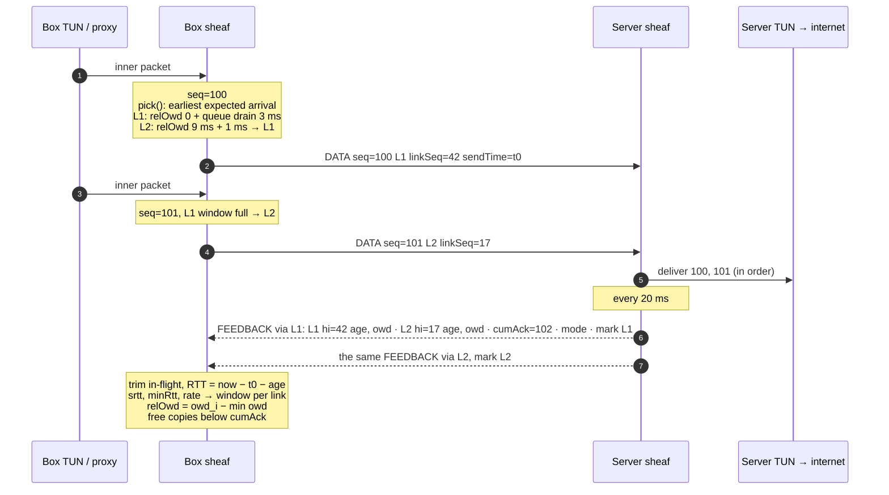
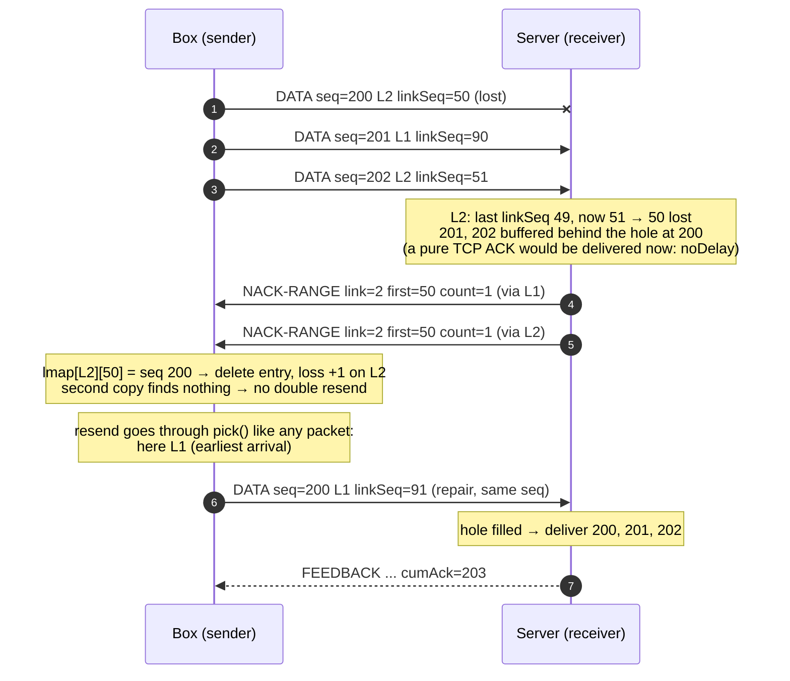
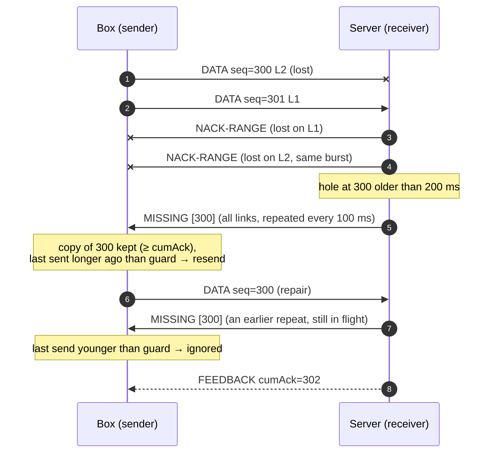
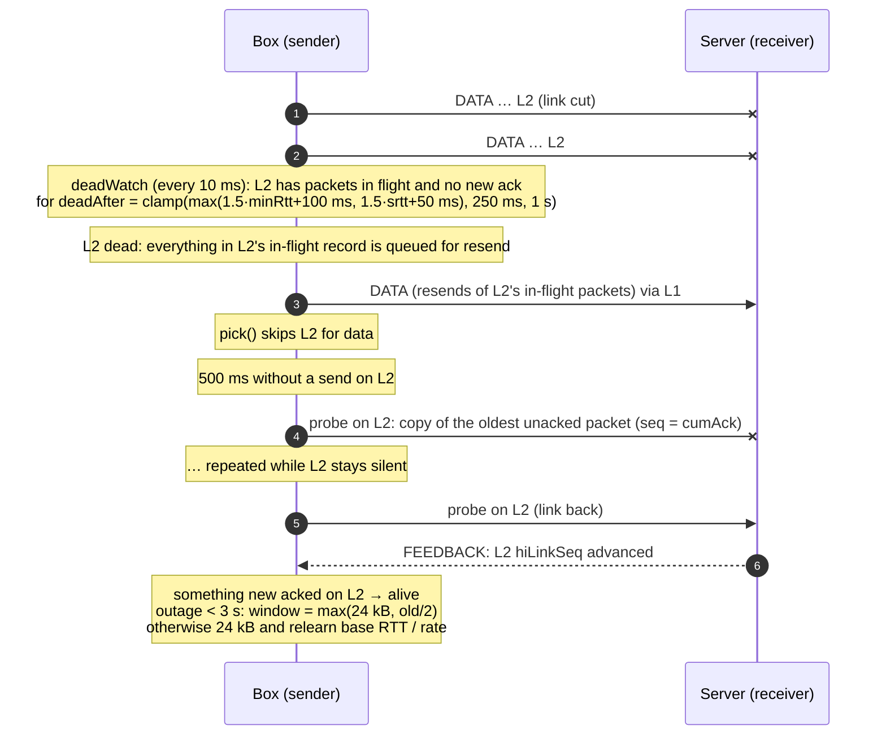
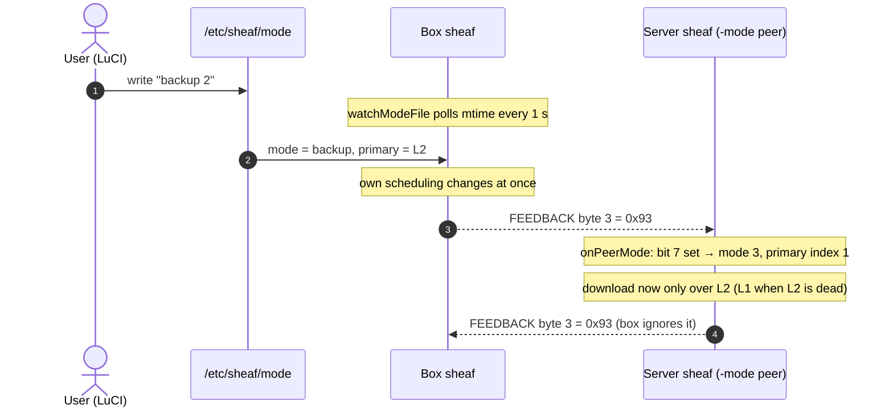
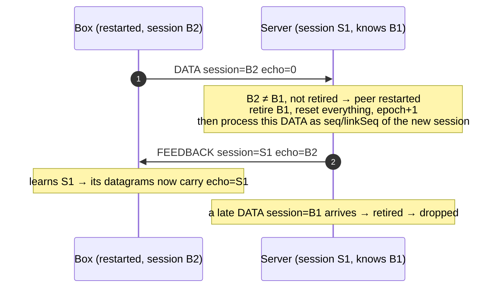
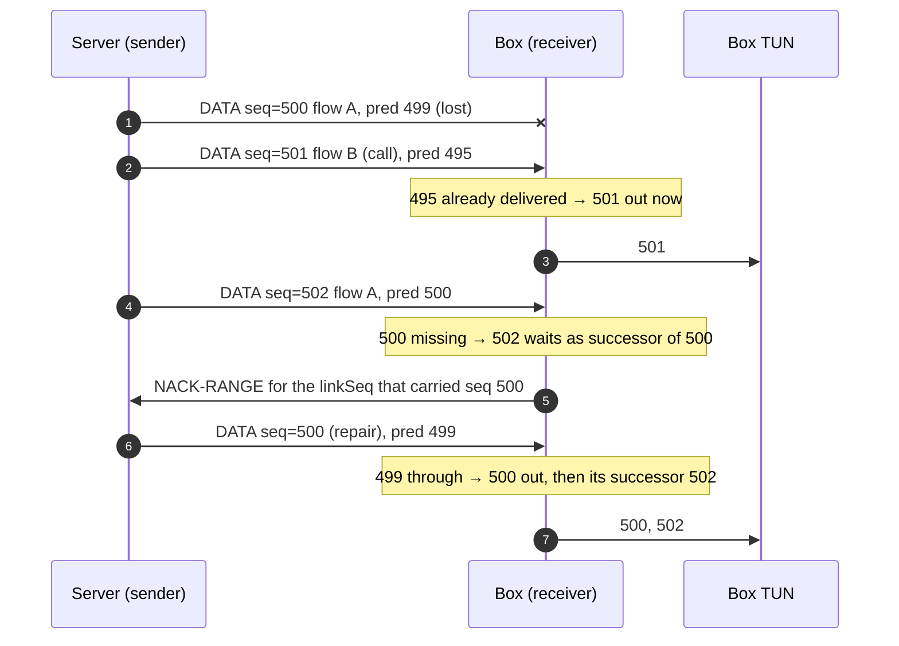

# sheaf wire protocol

This document describes every datagram sheaf sends between the box and the server. It was written from the source
(`sheaf/wire.go`, `sheaf/main.go`, `sheaf/modes.go`, `sheaf/flowrel.go`, `sheaf/proxy.go`, `sheaf/tproxy.go`,
`sheaf/v62.go`) and is current for v65 (= v64 with no behaviour change). v56–v61 changed no datagram, only how the sender and the
receiver use them; the transparent TCP proxy added proxy frame kind 6, v62 the empty DATA probe and the `-auth`
choices, v63–v65 nothing on the wire (see [14.1](#141-protocol-revisions)). When the code and this text disagree, the
code is right, and this document needs fixing.

## At a glance

A packet from a laptop on the box's LAN travels to the server like this, on one of the modems:

```
 ┌──────┬──────┬─────────┬──────┬───────┬──────────────────┬────────────────────┬─────────────────┬─────────┬──────┐
 │ IPv4 │ UDP  │ ESP     │ IV   │ UDP   │ sheaf header     │ inner packet       │ sheaf trailer   │ ESP pad │ ICV  │
 │ 20 B │ 8 B  │ 8 B     │ 16 B │ 8 B   │ 24 B             │ up to 1328 B       │ 16 B            │ 2–17 B  │ 16 B │
 └──────┴──────┴─────────┴──────┴───────┴──────────────────┴────────────────────┴─────────────────┴─────────┴──────┘
  modem   port   SPI and          7001 → magic, type,        the laptop's IP     session, echo,
  address 4500   sequence         47001  seq, linkSeq,       packet, unchanged   SipHash tag
  → server (NAT-T)                       send time,          (or a frame of
                                         flow predecessor    the TCP proxy)
                                 ├─────── encrypted by ESP (AES-256-CBC on a box, AES-GCM on a hub) ───────┤
                ├────────────────────── authenticated by the ESP ICV (HMAC-SHA-256) ───────────────────────┤
                                         ├──────────── authenticated by sheaf's tag ─────────────┤
```

sheaf itself only produces the part from the inner UDP header to the sheaf trailer: one ordinary UDP datagram per
packet. The kernel's IPsec (transport mode, UDP-encapsulated because the modems sit behind carrier-grade NAT) wraps it
on the way out. The inner packet is never split or merged.

There are four packet types:

1. **DATA** carries one packet from one end's TUN device (or one proxy frame) to the other. It has two numbers: `seq`
   orders the whole bundle, and `linkSeq` counts the packets on this one link, so a jump means exactly those packets
   were lost.
2. **FEEDBACK**, every 20 ms on every link, says per link "I have everything up to linkSeq X, and packets take this
   long". It also carries "I have everything below seq Y" and the mode the box has chosen.
3. **NACK-RANGE** says "on link L, linkSeq A … B never arrived". It is sent once, as soon as the gap is seen, and the
   sender resends those packets over the best link.
4. **MISSING** is the safety net: "I still miss seq P, Q, R …", repeated every 100 ms while a hole lasts. It covers
   the case where a NACK-RANGE was lost too.

Every datagram ends with the same 16-byte trailer: who sent it (session id), whom it is meant for (echo), and a SipHash
tag under the shared key. The byte-level details follow.

Contents

1. [Conventions](#1-conventions)
2. [The datagram: header, body, trailer](#2-the-datagram)
3. [Trailer: session, echo, authentication tag](#3-trailer-session-echo-tag)
4. [Type 1: DATA](#4-type-1-data)
5. [Type 2: FEEDBACK](#5-type-2-feedback)
6. [Type 3: MISSING (still-missing report)](#6-type-3-missing)
7. [Type 4: NACK-RANGE (link gap)](#7-type-4-nack-range)
8. [Payload of DATA: IP packet or proxy frame](#8-payload-of-data)
9. [Receiving a datagram: the order of checks](#9-receiving-a-datagram)
10. [Sequence diagrams](#10-sequence-diagrams), including [per-flow release](#107-per-flow-release-v53)
11. [Worked examples, byte by byte](#11-worked-examples)
12. [Sizes and the MTU budget](#12-sizes-and-the-mtu-budget)
13. [Timers and constants](#13-timers-and-constants)
14. [Compatibility rules](#14-compatibility-rules)

---

## 1. Conventions

| item | rule |
|---|---|
| transport | one UDP socket per **link** on each end; one sheaf datagram = one UDP datagram, never split or merged |
| link numbering | links are numbered 1..N in the order of `-links` on each end. Since v55 the two ends may list a different number of links and in another order: each link learns the far end's number of its socket pair and is paired by it, see [5.4](#54-link-pairing-v55) (a hub with 2 links can use the server's links 3 and 4) |
| byte order | all integers are **big endian** (network order), unsigned unless noted |
| time unit | microseconds (µs) on a **process-relative monotonic clock**: 0 = the moment the sending process started. The two ends' clocks are never compared with each other directly, see [5.3](#53-how-the-sender-uses-a-feedback) |
| sequence arithmetic | 32-bit serial numbers: `a` is after `b` when `int32(a - b) > 0`; wrap-around is handled |
| magic | every datagram starts with `0x5A` |
| version field | none; see [Compatibility rules](#14-compatibility-rules) |
| encryption | none at this layer. Confidentiality and anti-replay come from IPsec ESP underneath (see [HOW-IT-WORKS.md](HOW-IT-WORKS.md#security)) |

Every datagram has the same outer shape:

```
 0                   1                   2                   3
 0 1 2 3 4 5 6 7 8 9 0 1 2 3 4 5 6 7 8 9 0 1 2 3 4 5 6 7 8 9 0 1
+-+-+-+-+-+-+-+-+-+-+-+-+-+-+-+-+-+-+-+-+-+-+-+-+-+-+-+-+-+-+-+-+
|  magic 0x5A   |     type      |  type-specific (2 bytes)      |
+-+-+-+-+-+-+-+-+-+-+-+-+-+-+-+-+-+-+-+-+-+-+-+-+-+-+-+-+-+-+-+-+
|                                                               |
~                type-specific header and body                  ~
|                                                               |
+-+-+-+-+-+-+-+-+-+-+-+-+-+-+-+-+-+-+-+-+-+-+-+-+-+-+-+-+-+-+-+-+
|                    session (sender's id)                      |  \
+-+-+-+-+-+-+-+-+-+-+-+-+-+-+-+-+-+-+-+-+-+-+-+-+-+-+-+-+-+-+-+-+   |
|              echo (receiver's id as the sender knows it)      |   |  trailer,
+-+-+-+-+-+-+-+-+-+-+-+-+-+-+-+-+-+-+-+-+-+-+-+-+-+-+-+-+-+-+-+-+   |  16 bytes
|                                                               |   |
+            tag = SipHash-1-3(key, everything above)           +   |
|                                                               |  /
+-+-+-+-+-+-+-+-+-+-+-+-+-+-+-+-+-+-+-+-+-+-+-+-+-+-+-+-+-+-+-+-+
```

The four types:

| type | name in code | direction | how often | sent on |
|---|---|---|---|---|
| 1 | `tData` | both | every packet read from the TUN device, every proxy frame, every repair | one link chosen by the scheduler (sometimes two, see dupWorthy and redundant mode) |
| 2 | `tFeedback` | both | every 20 ms while data flows, every 2 s when idle | **every** link, one copy each (identical except the v55 link mark) |
| 3 | `tNack` | both, `-reliable` only | every 100 ms while a hole older than 200 ms exists | **every** link |
| 4 | `tNackR` | both | once per detected gap in a link's numbering | **every** link |

Each end is both sender and receiver: the box sends upload data and receives download data, the server the other way
round. Everything below applies to both directions.

---

## 2. The datagram

```
| header (type-specific) | body (type-specific) | trailer (16 B) |
```

The trailer is appended by `seal()` (`wire.go`) to every datagram of every type, just before the `sendmmsg` call. The
receiver strips it in `rd()` before looking at anything else. A datagram shorter than 4 + 16 bytes is dropped.

---

## 3. Trailer: session, echo, tag

| offset from end | size | field | set by the sender | used by the receiver |
|---|---|---|---|---|
| −16 | 4 | `session` | `mySession`: a random non-zero 32-bit id chosen at process start (`crypto/rand`) | identifies the peer's incarnation; a new value = the peer restarted |
| −12 | 4 | `echo` | the peer's session as this sender last learned it, 0 while unknown | a value that is neither 0 nor the receiver's own session = the datagram was meant for a previous incarnation of the receiver |
| −8 | 8 | `tag` | `SipHash-1-3(k0, k1, bytes[0 : len−8])` (`-auth=sip`, default) or `HalfSipHash-1-3` with the 64-bit output (`-auth=half`, v62), 64-bit result, written big endian; covers header, body, session and echo. 0 with `-auth=off` or without a key | recomputed and compared; mismatch = drop, counted and logged (v62, at most every 10 s). With `-auth=off` it must be 0 |

### 3.1 The key

`-key FILE` reads 32 hex characters (16 bytes, whitespace trimmed). As in the SipHash reference, `k0` is bytes 0..7 and
`k1` bytes 8..15, each read as a **little-endian** 64-bit integer. The same key is installed on both ends
(`/etc/sheaf/sheaf.key`, mode 600). Without `-key` the tag field is not written (it is zero in practice) and not checked; that
is for the lab only, and a link with an unknown peer address (`>-`) refuses to start without a key.

**`-auth` (v62)** chooses the tag: `sip` (default, SipHash-1-3 as before), `half` or `off`; `true` / `false` are
accepted for `sip` / `off` (the first v62 builds had a boolean flag). Write it as `-auth=VALUE`.

- **`off`**, for links that run under IPsec only: ESP's HMAC-SHA-256 already authenticates every datagram (the box drops
  sheaf's plaintext UDP, the server's firewall drops it on the sheaf ports). The tag field stays and is written as 0;
  the receiver neither computes nor checks a tag, but it rejects a datagram whose tag field is **not** 0.
- **`half`**, for links WITHOUT IPsec on a 32-bit CPU: HalfSipHash-1-3 (Aumasson's reference `halfsiphash.c` with
  1 compression and 3 finalization rounds, the round counts of the Linux kernel's `hsiphash`) with the 64-bit output,
  read little endian into the 64-bit tag. It works on 32-bit words, which the MIPS32 box has natively (SipHash's 64-bit
  words are emulated there with 32-bit pairs). Its key is 64 bits by definition: bytes 0..7 of the key file XOR bytes
  8..15 (all 128 bits count), `k0` = the first 4 bytes of that and `k1` the next 4, little endian. A 64-bit key and a
  64-bit tag are plenty against off-path injection. `halfsiphash_test.go` checks a straightforward implementation
  against the 64 reference vectors (HalfSipHash-2-4-64) and the unrolled 1-3 against that implementation.

The datagram layout is the same in all three. Both ends must agree; a mismatch is a clear failure, never a misparse:

| sender | receiver | result |
|---|---|---|
| `sip` or `half` (`-key`) | `off` | every datagram rejected: "a tag where -auth=off expects none" |
| `off` | `sip` or `half` (`-key`) | every datagram rejected: "no tag (the peer runs -auth=off or without -key?)" |
| `sip` | `half`, or the other way | every datagram rejected: "sip tag where -auth=half expects half (the peer runs -auth=sip)" |
| tag, key A | the same tag, key B | every datagram rejected: "bad tag (another -key at the peer?)" |
| `off` or no key | `off` or no key | accepted |

Each rejection is counted (status `auth_rejects`) and logged as `Lx: datagram rejected: … auth mismatch?` at most once
every 10 s.

Why SipHash-1-3: it is the only per-packet cryptographic work sheaf does on the MIPS CPU of the box, which has no
64-bit arithmetic. SipHash-2-4 cost about 75 µs per 1448-byte datagram there; the unrolled SipHash-1-3 in `siphash.go`
costs about 15 µs. The tag gives integrity and origin authentication against off-path injection. It gives no replay
protection: ESP's sequence window provides that on the LTE path. `wire_test.go` checks the implementation against the
SipHash paper's reference vectors.

### 3.2 Session rules (`rd()` and `switchSession()` in `wire.go`)

1. If a key is set and the tag does not match, the datagram is dropped.
2. If `echo != 0` and `echo != mySession`, the datagram was meant for a previous incarnation of us. Its sequence
   numbers, acks and frames belong to a state we no longer have. If we do not know the peer's session yet, we learn it
   from this datagram, and we learn the peer's address too. The content is dropped. Our next datagrams then carry the
   right echo, and the peer resets (rule 5 on its side).
3. If we do not know the peer's session yet, we adopt `session`.
4. If `session` equals the known peer session, the datagram is processed.
5. If `session` is one of the last 8 sessions the peer **retired**, the datagram is a late packet of an old session and is dropped.
6. Any other `session` means the peer restarted. Under a write lock (no datagram is half-processed meanwhile), the old
   session is retired and **all** per-peer state is reset (`resetPeer`): global and per-link sequence numbers back to
   0, kept copies, cumulative ack, reorder buffer, proxy streams, and a fresh window regulator per link. The session
   epoch counter is incremented, so packets numbered under the old epoch that are still waiting in queues are discarded
   and never sent. Then the datagram is processed in the new state.

No clock is involved: the box has no real-time clock and may boot "in the past".

### 3.3 Address learning

The server is configured with `>-` (peer address unknown) for every link. The box sits behind carrier-grade NAT and
its modem addresses change on every redial. Any datagram that passes the tag check, on any type, updates the link's
peer address to the datagram's source address and port (`learnAddr`). This happens only when a key is set (or with `-auth=off`, where the IPsec SA
the datagram arrived through vouches for it): without either, anybody could redirect a link.

---

## 4. Type 1: DATA

Carries one inner packet: an IP packet from the TUN device, or one proxy frame.

```
 0                   1                   2                   3
 0 1 2 3 4 5 6 7 8 9 0 1 2 3 4 5 6 7 8 9 0 1 2 3 4 5 6 7 8 9 0 1
+-+-+-+-+-+-+-+-+-+-+-+-+-+-+-+-+-+-+-+-+-+-+-+-+-+-+-+-+-+-+-+-+
|  magic 0x5A   |   type = 1    |    link id    |     flags     |   0
+-+-+-+-+-+-+-+-+-+-+-+-+-+-+-+-+-+-+-+-+-+-+-+-+-+-+-+-+-+-+-+-+
|                     seq (global sequence)                     |   4
+-+-+-+-+-+-+-+-+-+-+-+-+-+-+-+-+-+-+-+-+-+-+-+-+-+-+-+-+-+-+-+-+
|                   linkSeq (per-link sequence)                 |   8
+-+-+-+-+-+-+-+-+-+-+-+-+-+-+-+-+-+-+-+-+-+-+-+-+-+-+-+-+-+-+-+-+
|                                                               |  12
+             sendTime (µs, sender's process clock)             +
|                                                               |
+-+-+-+-+-+-+-+-+-+-+-+-+-+-+-+-+-+-+-+-+-+-+-+-+-+-+-+-+-+-+-+-+
|   flow predecessor (flag 0x01) / legacy prevSeq (no flag)     |  20
+-+-+-+-+-+-+-+-+-+-+-+-+-+-+-+-+-+-+-+-+-+-+-+-+-+-+-+-+-+-+-+-+
|                                                               |  24
~        inner packet: IP packet (TUN) or proxy frame           ~
|                                                               |
+-+-+-+-+-+-+-+-+-+-+-+-+-+-+-+-+-+-+-+-+-+-+-+-+-+-+-+-+-+-+-+-+
|                      trailer (16 bytes)                       |
+-+-+-+-+-+-+-+-+-+-+-+-+-+-+-+-+-+-+-+-+-+-+-+-+-+-+-+-+-+-+-+-+
```

Header length `hdrLen` = 24.

| offset | size | field | set by the sender (`sendOn`) | used by the receiver (`onDatagram`, `deliver`) |
|---|---|---|---|---|
| 0 | 1 | magic | `0x5A` | must match, else drop |
| 1 | 1 | type | `1` | dispatch |
| 2 | 1 | link id | the sending link's number (1-based) | the receiver attributes the packet to the socket it arrived on; since v55 it also stores this byte (when not 0) as the far end's id of that link (`peerLid`), see [5.4](#54-link-pairing-v55) |
| 3 | 1 | flags | `0x01` (`hasFlowPrev`) when bytes 20..23 hold the flow predecessor (v53, IP packets with `-flowrel` on); `0` otherwise and from senders older than v53 | bit `0x01` set and the receiver's `-flowrel` on → per-flow release; otherwise strict `seq` order. Other bits are not read |
| 4 | 4 | `seq` | global sequence number of the inner packet, taken once per inner packet (`submitEp`); a **repair or duplicate copy keeps the same seq**. Starts at 0 in every session | reorder buffer key; the cumulative ack (`cumAck`) and the MISSING reports refer to it; a seq already delivered or buffered is a duplicate and dropped. Delivery order: see bytes 20..23 |
| 8 | 4 | `linkSeq` | per-link counter, +1 for every DATA sent on this link (first sends, repairs and copies alike); the first packet of a session on each link is 1 | the link is a FIFO, so a jump from the last seen `linkSeq` to this one means exactly the packets in between were lost → NACK-RANGE (`linkGap`); the highest value is reported back in FEEDBACK |
| 12 | 8 | `sendTime` | µs since the sender's process start, at the moment the packet was queued for this link | one-way delay sample `owd = now_rx − sendTime` (includes the unknown offset between the two process clocks); smoothed per link (EWMA 1/10, restarted after 500 ms of silence) and reported back in FEEDBACK. With `-iprelease` (v59) also the deadline of a buffered IP packet ([HOW-IT-WORKS](HOW-IT-WORKS.md#reliability-and-repair)) |
| 20 | 4 | flow predecessor | with flag `0x01`: the global `seq` of the previous packet of the **same flow** (hash of IP addresses, protocol and ports, as in the flow queue), or the packet's own `seq` if it is the first of its flow in this session. Repairs carry the same value as the original. Without the flag (non-IP payloads such as proxy frames, `-flowrel=false`, or a sender older than v53): the `seq` of the previous DATA sent on this link, kept only for debugging | with the flag: the packet is delivered as soon as its flow predecessor has gone out (delivered in order, or released early itself), else it waits as that packet's successor. Without the flag: not read, and the packet waits for strict `seq` order |
| 24 | n | inner | the IP packet or proxy frame, unmodified | handed to the TUN device or the proxy, see [8](#8-payload-of-data) |
| 24+n | 16 | trailer | see [3](#3-trailer-session-echo-tag) | |

Notes

- The sender keeps a record of every DATA it sent on a link until a FEEDBACK covers its `linkSeq` (`hist`: linkSeq, size,
  send time, seq, the inner bytes). These records drive bytes-in-flight, the RTT samples, dead-link reinjection, and
  the `linkSeq → seq` map for NACK-RANGE (the last 32768 entries per link).
- Repairs (resends after a NACK, a timeout or a dead link) are ordinary DATA packets with the **same `seq`** and a **new
  `linkSeq`** on whatever link the scheduler picks. The receiver drops whichever copy arrives second.
- **Empty DATA = quiet probe (v62).** A DATA packet without an inner packet (exactly 24 + 16 bytes) is the probe of a
  link that has been dead for 30 s. It carries a `seq` the receiver already has (reliable: the sender's `cumAck − 1`;
  non-reliable: the last seq sent). A v62 receiver only takes its `linkSeq`, one-way delay and arrival (reported in the
  next FEEDBACK, which it sends at once even when idle) and delivers nothing; a v61 receiver drops it as a duplicate
  (reliable mode). The sender keeps no copy for repair and does not NACK-map it.
- An inner packet never spans two DATA packets, and two inner packets never share one (see
  [HOW-IT-WORKS.md](HOW-IT-WORKS.md#no-fragmentation-across-links)).
- The receiver attributes a packet to the socket it arrived on; the link id (byte 2) only teaches it the far end's number
  of that socket pair (`peerLid`, v55; until v54 the byte was ignored). Bytes 20..23 are ignored only when flag `0x01` is clear.
- The sender keeps the flow predecessors in a ring indexed by `seq` (65 536 entries, the same bound as the kept
  copies), so a repair sent much later still carries the right value.

---

## 5. Type 2: FEEDBACK

Each end tells the other, for every link, how far it has received on that link and how late packets arrive. In
`-reliable` mode it also says up to which global `seq` it has everything. Byte 3 carries the sender's mode choice.

```
 0                   1                   2                   3
 0 1 2 3 4 5 6 7 8 9 0 1 2 3 4 5 6 7 8 9 0 1 2 3 4 5 6 7 8 9 0 1
+-+-+-+-+-+-+-+-+-+-+-+-+-+-+-+-+-+-+-+-+-+-+-+-+-+-+-+-+-+-+-+-+
|  magic 0x5A   |   type = 2    |  N (# links)  |   mode byte   |   0
+-+-+-+-+-+-+-+-+-+-+-+-+-+-+-+-+-+-+-+-+-+-+-+-+-+-+-+-+-+-+-+-+
|                                                               |   4
~        N link entries, 21 bytes each (link 1 first)           ~
|                                                               |
+-+-+-+-+-+-+-+-+-+-+-+-+-+-+-+-+-+-+-+-+-+-+-+-+-+-+-+-+-+-+-+-+
|  ack flag = 1 |          cumAck (4 bytes)  ...                |   4+21N   (only with -reliable)
+-+-+-+-+-+-+-+-+-+-+-+-+-+-+-+-+-+-+-+-+-+-+-+-+-+-+-+-+-+-+-+-+
|  ...cumAck    |  mark 0x4C    |  link id      | trailer ...   |   (mark: v55)
+-+-+-+-+-+-+-+-+-+-+-+-+-+-+-+-+-+-+-+-+-+-+-+-+-+-+-+-+-+-+-+-+
```

Link entry (21 bytes, entry *i* at offset `4 + 21·i`):

```
 0               1               2               3
+---------------+---------------+---------------+---------------+
| valid (0/1)   |            hiLinkSeq (u32) ...                |  +0
+---------------+---------------+---------------+---------------+
| ...hiLinkSeq  |              age (i64, µs) ...                |  +4
+---------------+---------------+---------------+---------------+
|                       ...age                  |  owd (i64) ...|  +8 / +12
+---------------+---------------+---------------+---------------+
|                    ...owd (i64, µs)                           |
+---------------+---------------+---------------+---------------+
| ...owd        |                                                  +20
+---------------+
```

| offset | size | field | set by the sender of the feedback (= the receiver of the data, `feedbackLoop`) | used by the receiver of the feedback (= the data sender, `onFeedback`) |
|---|---|---|---|---|
| 0 | 1 | magic | `0x5A` | must match |
| 1 | 1 | type | `2` | dispatch |
| 2 | 1 | N | number of links of the sender | gives the position of the cumAck block and the link mark. Since v55 it may differ from the receiver's own number of links (until v54 such a feedback was ignored entirely) |
| 3 | 1 | mode byte | `0x80 \| primary<<4 \| mode`, see [5.2](#52-the-mode-byte) | applied only by an end started with `-mode peer` |
| 4+21i | 1 | valid | 1 when at least one DATA arrived on the sender's link *i+1* in this session; otherwise 0 and the remaining 20 bytes are zero | entry skipped when 0. Which of the receiver's links an entry belongs to: [5.4](#54-link-pairing-v55) |
| 5+21i | 4 | hiLinkSeq | the highest `linkSeq` received on link *i* | everything sent on link *i* with `linkSeq ≤ hiLinkSeq` leaves the in-flight record: delivered, or lost (losses are reported separately by NACK-RANGE) |
| 9+21i | 8 | age | µs between the arrival of `hiLinkSeq` and the sending of this feedback (receiver's own clock) | subtracted from the RTT sample, so the time the receiver held the information does not count as path delay |
| 17+21i | 8 | owd | smoothed one-way delay of link *i* as the receiver measures it: `now − sendTime`, EWMA, in µs; it includes the offset between the two process clocks | only differences between links are used: `relOwd_i = owd_i − min_j owd_j` |
| 4+21N | 1 | ack flag | `1`; the 5-byte block is present only when the sender runs `-reliable` | block used only when the receiver runs `-reliable` too |
| 5+21N | 4 | cumAck | the next global `seq` the receiver is waiting for (`next`): it has everything below | raises the sender's `cumAck` (never lowers it); copies below it are freed |
| after the above | 1 | link mark | `0x4C` (`fbLidMark`, v55) | announces the link id byte (`fbLinkID`); absent from v54 peers, whose feedback ends here |
| +1 | 1 | link id | the number of the sender's link this copy is sent over | stored as the far end's id of the link the copy arrived on (`peerLid`), see [5.4](#54-link-pairing-v55); older peers check only a minimum length and ignore both bytes |
| end | 16 | trailer | | |

Length: `4 + 21·N` bytes, `+5` with `-reliable`, `+2` link mark (v55), `+16` trailer. With two links and `-reliable`: 69 bytes
(67 from a v54 peer).

### 5.1 When feedback is sent

- Every 20 ms (`fbEvery`), a feedback datagram is sent on **every** link. The copies are identical except the link mark
  (v55), which names the link each copy goes over. One surviving copy is enough, and a feedback arriving over link *k*
  also proves that link *k* works in the reverse direction (`fbRx`, status `last_fb_ms`).
- Not on a link that has been dead for 30 s while another link lives (v62): the far end gets the copies over the
  live links. The same holds for NACK-RANGE and MISSING. With no live link, every link gets them as before.
- An empty DATA (a quiet probe, v62) does not count as data for the idle rule below, but it triggers one feedback at
  the next 20 ms tick.
- Idle: when no DATA arrived for more than 200 ms, feedback is sent only every 2 s. This keeps the NAT mappings open
  and costs about 500 bit/s per link (around 11 MB per day per SIM) instead of about 0.9 GB per day.
- Several copies of the same feedback are harmless. The first copy trims the in-flight record. The later copies find
  `hiLinkSeq` already removed, so they produce no RTT sample and no double counting.

### 5.2 The mode byte

```
  7   6   5   4   3   2   1   0
+---+---+---+---+---+---+---+---+
| 1 |  primary  |     mode      |
+---+---+---+---+---+---+---+---+
```

| bits | meaning |
|---|---|
| 7 | 1 = "a mode is stated". An older peer sends 0 here, and 0 is ignored (no change) |
| 6..4 | primary link index, 0-based (0 = L1, 1 = L2, … up to 7 = L8); used by backup mode |
| 3..0 | mode: 0 = speed, 1 = smooth, 2 = redundant, 3 = backup; larger values are ignored |

Examples: `0x80` = speed, primary L1 · `0x81` = smooth · `0x82` = redundant · `0x93` = backup with primary L2.

Every feedback carries the sender's current mode. The box chooses: `-mode`, or the file given by `-modefile`, which
LuCI writes and sheaf polls once a second. The server runs `-mode peer` and adopts the box's choice from the next
feedback that arrives, so within about 20 ms to 1 s. The box never follows the server, because it does not run
`-mode peer`.

### 5.3 How the sender uses a feedback

For each of its own links, the receiver of the feedback takes the entry of the far end's link that this link's packets
arrive on ([5.4](#54-link-pairing-v55)); when that entry is valid, under the link's lock:

1. **Trim in-flight.** Drop the `hist` records with `linkSeq ≤ hiLinkSeq`, subtract their bytes from `inflight`, and add
   them to the delivery-rate counter (`ackBytes`). If something new was acknowledged, record `progress = now`. If the
   link was dead, it comes back to life (see [10.4](#104-dead-link-probe-revival)).
2. **RTT sample.** If the record for `hiLinkSeq` itself was found (the first copy of this feedback), then
   `rtt = now − sendTime(hiLinkSeq) − age`. Both times are on the sender's own clock, so no clock synchronisation is
   needed. This updates `srtt` (EWMA 1/8), the jitter estimate, and the base `minRtt`, and it may trigger a window change.
3. **Relative delay.** `relOwd = owd_i − min(owd)`, the minimum taken over all valid entries in this feedback. The scheduler adds it to the
   expected arrival time (it is the difference in one-way delay between the links, free of the clock offset).
4. **Delivery rate.** At least every 100 ms: `rate = ackBytes / elapsed`. `rateAvg` is an EWMA of 1/4. `rateMax` is the
   maximum over the current and the previous ~1 s bin.
5. **Loss bookkeeping.** NACK-RANGE counts are compared with the packets sent in the same window (max(srtt, 100 ms)).

Then `cumAck` (reliable) and the mode byte (if following).

### 5.4 Link pairing (v55)

A link is a pair of sockets, one on each end. The two ends number their links independently (order of `-links`), so
the same pair may be L2 on the box and L4 on the server. Each link therefore keeps the far end's number of its socket
pair, `peerLid`:

- learned from byte 2 of every DATA that arrives on it, and from the link mark of every FEEDBACK copy that arrives on it;
- forgotten (0) when a new session starts, because a restarted peer may list its links differently.

With it, a FEEDBACK from a far end with any number of links is applied: the receiver's link with `peerLid` = *j* takes
entry *j−1* (`farIdx`). A NACK-RANGE naming link *j* goes to the receiver's link whose `peerLid` is *j* (`byFarID`).
While `peerLid` is still 0 (no packet yet, or a v54 peer that sends no mark), the link's own position is used, as
before v55. Example: a hub with 2 links using the server's ports 3 and 4 (the server lists 4 links): the server's links 3 and 4
learn far ids 1 and 2 and take entries 0 and 1 of the hub's feedback; the server's links 1 and 2 hear nothing and
are skipped by the scheduler (no peer address).

---

## 6. Type 3: MISSING

The **still-missing report**, used only with `-reliable`. The receiver names the global sequence numbers that are still
missing below the highest one it holds. It is the safety net for the case where a NACK-RANGE itself was lost (on a
shared path a single burst can take a packet and its NACK together). Without it, only the head-of-line timeout would
repair such holes, at about one packet per second.

```
 0                   1                   2                   3
 0 1 2 3 4 5 6 7 8 9 0 1 2 3 4 5 6 7 8 9 0 1 2 3 4 5 6 7 8 9 0 1
+-+-+-+-+-+-+-+-+-+-+-+-+-+-+-+-+-+-+-+-+-+-+-+-+-+-+-+-+-+-+-+-+
|  magic 0x5A   |   type = 3    |       0       |       0       |   0
+-+-+-+-+-+-+-+-+-+-+-+-+-+-+-+-+-+-+-+-+-+-+-+-+-+-+-+-+-+-+-+-+
|                       missing seq #1                          |   4
+-+-+-+-+-+-+-+-+-+-+-+-+-+-+-+-+-+-+-+-+-+-+-+-+-+-+-+-+-+-+-+-+
|                       missing seq #2                          |   8
+-+-+-+-+-+-+-+-+-+-+-+-+-+-+-+-+-+-+-+-+-+-+-+-+-+-+-+-+-+-+-+-+
~                     ... up to 256 entries                     ~
+-+-+-+-+-+-+-+-+-+-+-+-+-+-+-+-+-+-+-+-+-+-+-+-+-+-+-+-+-+-+-+-+
|                      trailer (16 bytes)                       |
+-+-+-+-+-+-+-+-+-+-+-+-+-+-+-+-+-+-+-+-+-+-+-+-+-+-+-+-+-+-+-+-+
```

| offset | size | field | set by the receiver of the data (`missingReport`) | used by the data sender (`onNack`) |
|---|---|---|---|---|
| 0 | 1 | magic | `0x5A` | |
| 1 | 1 | type | `3` | |
| 2 | 2 | reserved | `0, 0` | not read |
| 4+4k | 4 | seq | ascending list of missing global `seq`, starting at `next`. At most 256 entries (1 kB); at most 8192 sequence numbers are scanned per report | for each seq: resend if a copy is still kept, the seq is not below `cumAck`, and the last transmission of that seq has passed its **guard**: since v59 (`-fixguard`) the repair time fixed when that transmission left, from its link (see [13](#13-timers-and-constants)); with `-fixguard=false`, max(30 ms, 1.5 × the largest srtt of the live links, a stuck link's counted only up to its healthy round trip) |

When: checked every 20 ms. A report is sent when the oldest packet in the reorder buffer has waited at least 200 ms
(`missAfter`; up to v57, 200 ms without progress, a clock that every trickling packet of a collapsed link reset), then
again every 100 ms (`missEvery`) while the holes last, on every link. Thanks to the guard, a repeated report, or its copy arriving
over the second link, does not cause duplicate resends: a packet that is still on its way is not "lost".
Minimum length 8 bytes (at least one entry).

---

## 7. Type 4: NACK-RANGE

"On link *L*, `linkSeq` *from* … *from + count − 1* never arrived." Because every link is a FIFO path, a jump in a
link's `linkSeq` identifies the lost packets exactly. There is no timer and no guessing involved.

```
 0                   1                   2                   3
 0 1 2 3 4 5 6 7 8 9 0 1 2 3 4 5 6 7 8 9 0 1 2 3 4 5 6 7 8 9 0 1
+-+-+-+-+-+-+-+-+-+-+-+-+-+-+-+-+-+-+-+-+-+-+-+-+-+-+-+-+-+-+-+-+
|  magic 0x5A   |   type = 4    |    link id    |   0 (resv.)   |   0
+-+-+-+-+-+-+-+-+-+-+-+-+-+-+-+-+-+-+-+-+-+-+-+-+-+-+-+-+-+-+-+-+
|                     first lost linkSeq                        |   4
+-+-+-+-+-+-+-+-+-+-+-+-+-+-+-+-+-+-+-+-+-+-+-+-+-+-+-+-+-+-+-+-+
|            count              |      trailer (16 bytes) ...   |   8
+-+-+-+-+-+-+-+-+-+-+-+-+-+-+-+-+-+-+-+-+-+-+-+-+-+-+-+-+-+-+-+-+
```

| offset | size | field | set by the data receiver (`nackRange`) | used by the data sender (`onNackRange`) |
|---|---|---|---|---|
| 0 | 1 | magic | `0x5A` | |
| 1 | 1 | type | `4` | |
| 2 | 1 | link id | the number of the receiver's own link on which the gap was seen (1-based) | selects the sender's link whose far id (`peerLid`) is this number; while no link has learned it, the link at that position if its far id is still unknown; otherwise dropped (`byFarID`, v55) |
| 3 | 1 | reserved | `0` | not read |
| 4 | 4 | first | first missing `linkSeq` | |
| 8 | 2 | count | number of consecutive missing `linkSeq`; capped at 4096 | for each `linkSeq` in the range, look up the global `seq` it carried (`lmap`) and **delete the entry**, so the copy of this NACK arriving over the other link repairs nothing twice. Count each hit as a loss on that link (loss regulator), then queue a resend of the kept copy unless it is below `cumAck` |
| 10 | 16 | trailer | | |

Length 10 + 16 = 26 bytes. The NACK-RANGE is sent **once**, on every link. If all copies are lost, the MISSING report
takes over. A gap at the very start of a session (first packet with `linkSeq` *k* > 1) also counts: the numbering of
each link starts at 1.

---

## 8. Payload of DATA

The receiver decides what the inner packet is by its first byte (`out()` in `proxy.go`):

| first byte | meaning | delivered to |
|---|---|---|
| high nibble 4 (`0x4?`) | IPv4 packet | written to the TUN device |
| high nibble 6 (`0x6?`) | IPv6 packet | written to the TUN device |
| `0x01`..`0x06`, length ≥ 7 | proxy frame | the built-in TCP proxy (`0x06` since revision 2; an older receiver ignores it) |
| anything else | ignored | — |

An IP header can never start with 0x01..0x05, so the two kinds cannot be confused.

### 8.1 Proxy frame

Used only with `-proxy` or `-transparent` on one end and `-serve` on the other, both with `-reliable`. The proxy terminates TCP on the
box. Only the byte stream travels through sheaf, and the far end opens the real TCP connection. No TCP runs between
the two ends, so only sheaf's per-link regulator sets the pace (no TCP-in-TCP).

```
 0                   1                   2                   3
 0 1 2 3 4 5 6 7 8 9 0 1 2 3 4 5 6 7 8 9 0 1 2 3 4 5 6 7 8 9 0 1
+-+-+-+-+-+-+-+-+-+-+-+-+-+-+-+-+-+-+-+-+-+-+-+-+-+-+-+-+-+-+-+-+
|     kind      |                 stream id ...                 |   0
+-+-+-+-+-+-+-+-+-+-+-+-+-+-+-+-+-+-+-+-+-+-+-+-+-+-+-+-+-+-+-+-+
| ...stream id  |            len                |  data ...     |   4
+-+-+-+-+-+-+-+-+-+-+-+-+-+-+-+-+-+-+-+-+-+-+-+-+-+-+-+-+-+-+-+-+
```

Frame header `fHdr` = 7 bytes: `kind u8 | stream u32 | len u16 | data[len]`.

| kind | name | data | meaning |
|---|---|---|---|
| 1 | OPEN | ASCII `host:port` | open a TCP connection to this target (the far end checks `-allow` and refuses with RST if the target is not listed or `-serve` is missing) |
| 2 | DATA | stream bytes, at most `-frame − 7` (1393 at `-frame 1400`, 1321 at `-frame 1328`) | bytes for the local socket, in order |
| 3 | FIN | none | the sender finished writing (half close); the receiver calls `CloseWrite` after the queued data |
| 4 | RST | none | abort the stream (error, refused dial, unknown stream) |
| 5 | WIN | u64: total bytes this side has written to its local socket | flow-control credit for the other side |
| 6 | OPENT | flags u8 (0) · window u32 · port u16 · address (4 bytes IPv4 or 16 bytes IPv6), 11 or 23 bytes | transparent open (revision 2): open a TCP connection to this address and port. The far end checks `-tallow` / `-tdeny` and `-tmax` and refuses with RST. *window* = the opener's receive window for this stream (see Credit) |

**Stream ids.** The side that opens a stream numbers it 1, 3, 5, …. On the wire, every frame carries the sender's own
key for the stream. The receiver flips bit 31 (`dirBit = 0x80000000`) to get its own key. A stream opened by the box as
1 is therefore stored by the server as `0x80000001`, and the server sends its frames with id `0x80000001`, which the box
flips back to 1. Both ends can open "stream 1" at the same time without the two being confused.

**Credit.** A sender may have at most 16 MiB (`streamWin`, v56; 4 MiB before, which capped one stream over four LTE
links) of a stream's bytes that the far end has not yet written to its socket. The receiver sends WIN each time it has
written another 1 MiB (`streamWin / 16`). A slow consumer therefore
slows only its own stream, and the shared receive path never blocks. For an OPENT stream the acceptor (server) may
have at most *window* bytes in flight towards the opener (the box sends WIN every *window* / 16 bytes written); the
other direction keeps 16 MiB. The box takes these windows from a budget (`-twin`, `-tbudget`), so its memory stays
bounded with many connections.

**Answer to OPENT.** After a successful dial the acceptor sends WIN with value 0 ("connected"): the opener knows the
far end has the stream. A refused open or a failed dial is answered with RST. A box that has heard nothing for a
stream 30 s after its OPENT resets it (an older server ignores kind 6).

**Ordering.** OPEN is submitted before any DATA of its stream. Since all frames go through the same in-order reliable
delivery, they arrive in that order. A DATA or FIN for an unknown stream is answered with RST (once per id); otherwise
the far end would wait for credit forever.

**Classes.** WIN frames are noDelay (delivered ahead of a hole). OPEN, OPENT, FIN, RST and WIN are dupWorthy (sent over two
links). DATA frames are neither.

### 8.2 Receiver-side classes

Besides per-flow release, which the sender marks with flag `0x01` and the flow predecessor (section 4), the receiver
classifies inner packets by itself, and nothing in the header marks these:

| class | which packets | effect |
|---|---|---|
| **noDelay** (`noDelay()`) | IPv4 TCP with ACK set, no payload, no SYN/FIN/RST; proxy WIN frames | delivered immediately even if a hole precedes them; their slot is kept as a placeholder so they are not delivered twice. They only report progress, and holding them back would slow the other direction |
| **live UDP** (smooth mode only, `isUDP()`) | IPv4 or IPv6 UDP | waits behind a hole at most `holdTime`, then is delivered ahead of it |

On the sending side, **dupWorthy** (`dupWorthy()`) packets are inner packets of at most 512 bytes that are proxy
control frames (all kinds except DATA), ICMPv4, DNS (UDP port 53) or TCP SYN/FIN/RST. They are sent with the same `seq`
on a second live link as well, in every mode. The first copy to arrive counts, and the second is dropped as a
duplicate. Plain TCP ACKs are not duplicated: there are thousands per second during a download, and each costs CPU on
the box.

---

## 9. Receiving a datagram

`recvLoop` reads up to 32 datagrams per `recvmmsg` call. `onDatagram` then processes each one in this order:

```
datagram (len L)
  │
  ├─ L < 20 ................................................ drop
  ├─ key set and tag ≠ SipHash(bytes[0:L-8]) ................ drop
  ├─ echo ∉ {0, mySession} ................ learn peer session/address, drop
  ├─ session retired ....................................... drop
  ├─ session new (peer restarted) ........ retire old, reset all state, continue
  ├─ learn source address for this link (key set only)
  ├─ byte 0 ≠ 0x5A ......................................... drop
  └─ byte 1:
       1 DATA     → byte 2 → far link id (peerLid, v55)
                    linkSeq gap? → NACK-RANGE on all links
                    update hiLinkSeq / owd / rx counters
                    deliver(seq, inner): duplicate? noDelay? flow predecessor through
                    (flag 0x01)? → out now, then its waiting successors;
                    else buffer (smooth mode: UDP at most holdTime); in-order pass
       2 FEEDBACK → mark reverse path alive (fbRx); link mark → far link id (v55); onFeedback
       3 MISSING  → onNack
       4 NACK-R   → onNackRange
       other      → ignored
```

---

## 10. Sequence diagrams

The diagrams use the box as the data sender (upload). Download works the same way with the roles swapped. "L1"/"L2"
are the two links (O2 and Vodafone on the test box).

### 10.1 Normal data flow over two links, feedback cycle



### 10.2 A loss on one link, NACK-RANGE, repair on the other



### 10.3 The NACK itself is lost: MISSING report



As a last resort, the head-of-line packet (`cumAck`) is resent after an RTO of max(1 s, its own repair time) (v59,
`-fixguard`; before, max(1 s, 3 × the largest srtt)), with back-off capped at 2 ×.

### 10.4 Dead link, probe, revival



A probe is always a **copy**. When the scheduler hands a packet to a dead link as a probe, the original also goes over
a live link, so no data waits for a dead link.

v62: after 30 s dead the link gets no copies, only an empty DATA (quiet probe) every 5 s, and no FEEDBACK, NACK-RANGE
or MISSING while another link lives. Its acknowledgement revives the link exactly as above.

v63: a link can also die with nothing in flight. The peer sends feedback over every link at least every 2 s; a link
that brought no feedback for 8 s while another link brought some within the last 4 s is declared dead, and gets an
empty DATA as its probe at once (there is no unacknowledged packet to probe with). If every link is silent, the cause
is common (the server, the path) and no link is declared dead for it. v64: a link that has just come back, because its
probe was acknowledged over another link, is not declared dead again before its own feedback had time to arrive.

### 10.5 Mode change



### 10.6 Restart of one end



If instead the **server** restarts (new session S2), its datagrams arrive at the box with `echo = 0`, and the box
treats S2 as a restart of the peer and resets. Datagrams the box sent before it learned S2 still carry `echo = S1`.
The server recognises them as addressed to its previous incarnation, learns the box's session and address from them,
and drops their content.

### 10.7 Per-flow release (v53)

A bulk download (flow A) loses a packet. A call (flow B) shares the bundle and must not wait for that repair.



Without the flag (an older sender), 501 would have waited for the repair of 500 like everything else.

---

## 11. Worked examples

These bytes were produced by running sheaf's own encoders (`sendOn`, `seal`, `feedbackLoop`, `nackRange`,
`missingReport`) in a test harness, with:

- key `000102030405060708090a0b0c0d0e0f` (the SipHash test key, **not** a real key),
- sender session `0x1a2b3c4d`, the peer's session as known to the sender `0x5e6f7081`.

### 11.1 DATA

Global seq 100, the 42nd packet on link 1, sent at 1 234 567 890 µs of the sender's clock. The previous packet of the
same flow had seq 97. It carries a 32-byte ICMP echo request 10.66.0.2 → 10.66.0.1 (the checksums in the example inner
packet are not real).

```
0000  5a 01 01 01 00 00 00 64 00 00 00 2a 00 00 00 00
0010  49 96 02 d2 00 00 00 61 45 00 00 20 ab cd 00 00
0020  40 01 00 00 0a 42 00 02 0a 42 00 01 08 00 f7 ff
0030  00 00 00 00 de ad be ef 1a 2b 3c 4d 5e 6f 70 81
0040  1a b1 34 fd 81 17 85 64
```

| offset | bytes | field | value |
|---|---|---|---|
| 0 | `5a` | magic | |
| 1 | `01` | type | DATA |
| 2 | `01` | link id | L1 |
| 3 | `01` | flags | bytes 20..23 hold the flow predecessor |
| 4 | `00 00 00 64` | seq | 100 |
| 8 | `00 00 00 2a` | linkSeq | 42 |
| 12 | `00 00 00 00 49 96 02 d2` | sendTime | 1 234 567 890 µs |
| 20 | `00 00 00 61` | flow predecessor | 97: delivered as soon as seq 97 is through, whatever happens to 98 and 99 (other flows) |
| 24 | `45 00 00 20 … de ad be ef` | inner | IPv4 (first nibble 4) → TUN; 32 bytes |
| 56 | `1a 2b 3c 4d` | session | sender |
| 60 | `5e 6f 70 81` | echo | receiver as known |
| 64 | `1a b1 34 fd 81 17 85 64` | tag | SipHash-1-3 over bytes 0..63 |

Total 72 bytes = 24 + 32 + 16.

### 11.2 FEEDBACK

Two links, `-reliable`, the sender is in backup mode with primary L2. On L1 the highest linkSeq is 42, on L2 17; the
newest packets were held 21 130 µs before this feedback left; smoothed one-way delay 23 456 µs on L1 and 31 000 µs on
L2; the sender has everything below seq 2001.

```
0000  5a 02 02 93 01 00 00 00 2a 00 00 00 00 00 00 52
0010  8a 00 00 00 00 00 00 5b a0 01 00 00 00 11 00 00
0020  00 00 00 00 52 8a 00 00 00 00 00 00 79 18 01 00
0030  00 07 d1 4c 01 1a 2b 3c 4d 5e 6f 70 81 93 e8 b9
0040  54 43 2f b7 ef
```

| offset | bytes | field | value |
|---|---|---|---|
| 0 | `5a 02` | magic, type | FEEDBACK |
| 2 | `02` | N | 2 links |
| 3 | `93` | mode byte | 1 · primary 001 · mode 0011 = backup, primary L2 |
| 4 | `01` | L1 valid | yes |
| 5 | `00 00 00 2a` | L1 hiLinkSeq | 42 |
| 9 | `00 00 00 00 00 00 52 8a` | L1 age | 21 130 µs |
| 17 | `00 00 00 00 00 00 5b a0` | L1 owd | 23 456 µs |
| 25 | `01` | L2 valid | yes |
| 26 | `00 00 00 11` | L2 hiLinkSeq | 17 |
| 30 | `00 00 00 00 00 00 52 8a` | L2 age | 21 130 µs |
| 38 | `00 00 00 00 00 00 79 18` | L2 owd | 31 000 µs |
| 46 | `01` | ack flag | cumAck follows |
| 47 | `00 00 07 d1` | cumAck | 2001 |
| 51 | `4c 01` | link mark (v55) | this copy goes over link 1 |
| 53 | `1a 2b 3c 4d 5e 6f 70 81` | session, echo | |
| 61 | `93 e8 b9 54 43 2f b7 ef` | tag | |

Total 69 bytes = 4 + 2·21 + 5 + 2 + 16 (the copy over link 2 ends `4c 02`). The data sender would compute `relOwd(L1) = 0`, `relOwd(L2) = 7 544 µs`.

### 11.3 NACK-RANGE

On link 2, linkSeq 18, 19 and 20 were lost.

```
0000  5a 04 02 00 00 00 00 12 00 03 1a 2b 3c 4d 5e 6f
0010  70 81 b3 d9 55 7c 9c 6e 16 80
```

`5a` magic · `04` NACK-RANGE · `02` link 2 · `00` · `00 00 00 12` first = 18 · `00 03` count = 3 · session · echo ·
tag. 26 bytes.

### 11.4 MISSING

The receiver waits for seq 2001 (`next`) and holds 2003 and 2005: missing are 2001, 2002 and 2004.

```
0000  5a 03 00 00 00 00 07 d1 00 00 07 d2 00 00 07 d4
0010  1a 2b 3c 4d 5e 6f 70 81 73 ba b1 a4 a7 73 09 a9
```

`5a 03 00 00` · `000007d1` 2001 · `000007d2` 2002 · `000007d4` 2004 · session · echo · tag. 32 bytes.

### 11.5 A proxy OPEN frame inside DATA

The box opens stream 1 to `127.0.0.1:5201` (the inner packet at offset 24 of a DATA packet):

```
01  00 00 00 01  00 0e  31 32 37 2e 30 2e 30 2e 31 3a 35 32 30 31
│   │            │      "127.0.0.1:5201"
│   │            └ len 14
│   └ stream 1 (the sender's key; the server stores it as 0x80000001)
└ kind OPEN
```

---

## 12. Sizes and the MTU budget

| item | bytes |
|---|---|
| DATA overhead per inner packet | 24 header + 16 trailer = **40** |
| inner packet, TUN | ≤ 1320 (MTU of `shf0` on both ends) |
| inner packet, proxy frame | ≤ `-frame` (7-byte frame header included) |
| UDP payload of the largest DATA at `-frame 1328` | 24 + 1328 + 16 = 1368 |
| + UDP 8 + IPv4 20 | 1396 |
| + ESP transport in UDP (NAT-T): UDP 8, ESP header 8, IV 16, padding to the AES block + 2, ICV 16 | ≈ 1460, which fits in 1500 |
| the same at `-frame 1400` | ≈ 1524, **fragmented** (measured: tens of thousands of fragments per test, −34 % / −47 %) |
| FEEDBACK, 2 links, reliable | 69 (v55; 67 from a v54 peer) |
| NACK-RANGE | 26 |
| MISSING | 20 + 4 per missing seq (≤ 1044) |

Hence `-frame 1328` whenever the links run under IPsec (`FRAME=1328` on the box), and `-frame 1400` without it.

---

## 13. Timers and constants

| name | value | where | what |
|---|---|---|---|
| `fbEvery` | 20 ms | main.go | feedback interval while data flows |
| idle feedback | 2 s after 200 ms without data | `feedbackLoop` | keeps NAT mappings, saves SIM data |
| `missAfter` / `missEvery` / `missMax` / `missScan` | 200 ms / 100 ms / 256 / 8192 | main.go | MISSING report; the clock is the age of the oldest packet in the reorder buffer (v58) |
| repair time (v59, `-fixguard`) | send time + max(srtt, base + q) + q + 4 × jitter + 20 ms of the link the packet left on, q = the queue the window cap allows; 1 s while the link is not measured | `repairSpanUs`, `setDue` | fixed per transmission when it leaves |
| NACK guard | the repair time (v59); with `-fixguard=false` max(30 ms, 1.5 × max srtt of live links) | `onNack` | no resend of a packet still in flight |
| RTO (head of line only) | max(1 s, the head's repair time) (v59); with `-fixguard=false` max(1 s, 3 × max srtt); back-off ≤ 2× | `rtxTick` | last-resort repair |
| stuck link (v58) | oldest unacked older than `-slowk` × healthy round trip and its queue not drained within twice that | `stuckCheck`, `deadTick` | no new data; with `-rescue` its late packets go again over the other links |
| receiver release (v59, `-iprelease B`, off) | send time + max over delivering links of min(owd EWMA, owd min + 300 ms) + 4 × owd jitter + B, checked every 5 ms | `releaseWatch` | reliable: IP packets past a hole delivered, the hole repaired and delivered late |
| `deadAfter` | clamp(max(1.5·minRtt + 100 ms, 1.5·srtt + 50 ms), 250 ms, 1 s) | `derive` | silence with data in flight → link dead |
| dead check | every 10 ms | `deadWatch` | also inside `pick` |
| `starveFor` | 500 ms | main.go | a link not sent on for this long gets a probe |
| `quietAfter` / `quietProbeEvery` | 30 s / 5 s | v62.go | a link dead this long gets only an empty probe every 5 s, no control datagrams while another link lives |
| `fbDeadAfter` / `fbFreshFor` | 8 s / 4 s | v62.go | v63: no feedback over a link for 8 s while another link had feedback within 4 s → dead even with nothing in flight; v64: not right after it came back |
| warm restart | outage < 3 s → window max(24 kB, old/2) | `onFeedback` | otherwise 24 kB and relearn |
| `holdTime` | clamp(1.5 × (max owd − min owd) + 40 ms, 20 ms, 400 ms); 100 ms without measurements | `holdTime` | smooth mode: how long UDP waits behind a hole; non-reliable mode: when a hole is skipped |
| `maxCopies` | 65 536 packets | main.go | reliable: kept unacknowledged copies; above this the TUN is not read (back-pressure) |
| copies, non-reliable | last 16 384 | `submitEp` | for NACK repair |
| `lmap` per link | last 32 768 linkSeq → seq | `sendOn` | NACK-RANGE lookup |
| retired sessions | last 8 | wire.go | late packets of old sessions dropped |
| `streamWin` | 16 MiB per stream, WIN every 1 MiB (v56; 4 MiB before) | proxy.go | proxy credit |
| flow queue | 1024 buckets, quantum 1514 B, `-fqlimit` 1 MiB (256 KiB before the v59 deployment) | `fq.go` | sender side, between TUN and the scheduler; not visible on the wire |
| link transmit queue | `-txqcap` 45 kB (v59) | `txqFull` | a link with a fuller queue is no candidate in the scheduler |
| flow predecessor ring | 65 536 entries by seq | `flowrel.go` | the flow predecessor of every kept seq |
| `batch` / `gsoMax` | 32 messages per `sendmmsg`/`recvmmsg`, ≤ 32 datagrams per GSO message | main.go | syscall batching |

The window regulator's constants are described in [HOW-IT-WORKS.md](HOW-IT-WORKS.md#per-link-window-regulator).

---

## 14. Compatibility rules

There is no version field. The rules that keep different builds interoperable:

- **Flow predecessor.** Byte 3 of DATA was always 0 before v53, and bytes 20..23 held a value no receiver read. A v53
  receiver delivers a packet without flag `0x01` in strict order, and an older receiver ignores both fields, so v53
  works against older peers (with strict order).
- **Mode byte.** Byte 3 of FEEDBACK was 0 before modes existed. A 0 (bit 7 clear) means "nothing stated" and changes
  nothing, so old and new peers interoperate.
- **cumAck block.** It is optional and announced by its flag byte. A receiver that does not run `-reliable` ignores it.
  Both ends must agree on `-reliable`, though: a reliable receiver never skips a hole, and a non-reliable sender stops
  keeping copies.
- **Number of links (v55).** Links are paired by the far end's link id ([5.4](#54-link-pairing-v55)), so two v55 ends
  may have different numbers of links in any order. The link mark at the end of FEEDBACK is ignored by v54, which only
  checks a minimum length. A v54 end still ignores every FEEDBACK whose N differs from its own link count and pairs by
  position: against a v54 peer, keep the same number of links in the same order.
- **Unknown types** are ignored. A new type can be added without breaking an old peer, which will simply not use it.
- **Key.** Both ends must use the same key, or neither (lab only).
- **`-auth` (v62).** Both ends must run the same `-auth`; a mismatch rejects every datagram (logged), see [3.1](#31-the-key).
- **Empty DATA (v62).** A v61 receiver in reliable mode drops a quiet probe as a duplicate; in non-reliable mode its
  seq may not have arrived yet there, so run v62 on both ends.
- **Transparent opens (revision 2).** A receiver before revision 2 ignores frame kind 6. Its DATA frames then meet an
  unknown stream and are answered with RST; a connection where the server speaks first waits until the box resets it
  (30 s). Update the server before switching `TPROXY=1` on a box. A revision 2 server still accepts kind 1 OPEN
  under `-allow` as before.

### 14.1 Protocol revisions

There is no version field on the wire; the revision only names what a build understands.

| revision | builds | change |
|---|---|---|
| 1 | up to v61 | DATA, FEEDBACK, NACK-RANGE, MISSING; proxy frames 1–5 |
| 2 | transparent proxy (59-r4 box package, main after v61) | proxy frame 6 OPENT; WIN 0 as its answer |
| 3 | v62 | empty DATA = quiet probe of a long-dead link; `-auth=off`: tag field 0; `-auth=half`: HalfSipHash-1-3 tag |
| 3 | v63, v64, v65 | no wire change (v63/v64 only change when a link counts as dead; v65 = v64 with no behaviour change) |

